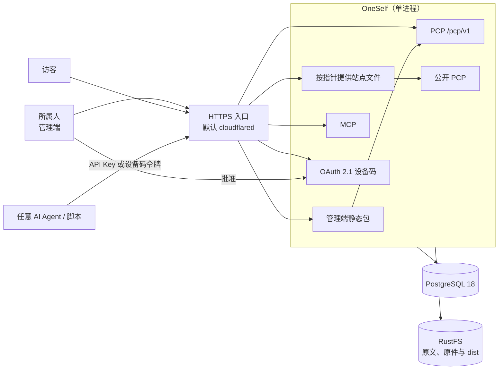
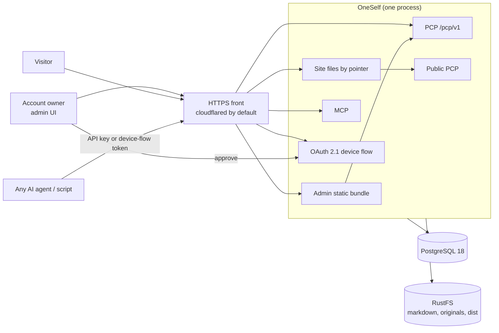

# OneSelf 技术架构

状态：可实施 v0.14  
对应需求：`docs/PRD.md` v0.14  
日期：2026-10-20

本文只回答怎么实现当前 MVP。不引入需求里已经明确不做的能力。协议行为以 PRD 为准；本文是同一批规则的路径、事务和部署。两边不一致时先改文档。

公开落地页和简历是浏览器里的静态包。应用按指针把文件发出去，不在请求时把资料渲染进 HTML。定制包存在应用自己的发布存储里，不交给 Caddy。

---

## 1. 实现原则

1. **一个可部署应用。** API、MCP、OAuth、管理端静态文件和已发布站点都由同一个进程提供。不拆微服务，也不另起静态站点进程。
2. **前后端分开构建，同一个进程部署。** 管理端和公开站点是前端包。资料、权限和发布指针在后端。
3. **业务规则不写在路由里。** HTTP 和 MCP 只做认证、解析和返回。规则放在领域模块。两种入口调用同一组操作。
4. **外部存储可替换。** 原件和站点包通过端口写入。领域层不出现厂商 SDK。部署只有 RustFS 一种对象存储，没有本地目录模式。
5. **一件事一个事务。** 写入一页并更新它的投影、移动站点指针，都必须在一个数据库事务里完成。对象先写到内容哈希键；事务失败时没有任何指针，公开 URL 读不到。
6. **公开文档和接口共用事实。** Skill 可以手写，但操作名、路径和错误码以代码注册表为准。不一致时测试失败。

---

## 2. 总体结构

```text
所属人浏览器 / 访客浏览器 / Agent
    │
    ▼
┌──────────────────────────────────────────┐
│              OneSelf 应用                 │
│                                          │
│  静态层    管理端、已发布站点、Skill       │
│  接口层    /pcp/v1、公开 PCP、MCP、OAuth   │
│  操作层    同一份操作注册表                │
│  领域层    页、原件、检索、授权、站点指针   │
│  端口      对象存储、时钟、Markdown 解析   │
└──────────┬───────────────┬───────────────┘
           │               │
     PostgreSQL        RustFS（S3 兼容）
```

Agent 不连接数据库和对象存储，也不读取磁盘路径。它只调用 PCP 的 HTTP API 或同一进程里的 MCP。所属人密码、OAuth 签名密钥、API Key 原文和对象存储密钥只存在于服务端环境变量或只存哈希的表里。

### 系统总览图

访客只拿到当前指针指向的静态文件，再由浏览器匿名读取公开 PCP。任意 AI Agent 二选一接入：使用所属人批准生成的 API Key，或走 OAuth 2.1 设备码、由所属人在管理端批准。浏览器和 Agent 都先到达唯一的 HTTPS 入口，再进入这一个进程。默认入口是 cloudflared。



<details>
<summary>English version</summary>



</details>

---

## 3. 技术选型

| 选择 | 用什么 | 为什么不用别的 |
| --- | --- | --- |
| 语言 | TypeScript `strict` | 操作注册表、管理端和公开客户端可以共享类型 |
| 运行时 | Node.js 24 LTS | 与当前 Active LTS 对齐。不使用尚未成为 LTS 的更大版本做生产运行时 |
| 包管理 | pnpm | 只用这一套。工作区用来放服务端、管理端、原始页面和公开客户端。不提交 npm 或 Yarn 的锁文件 |
| 服务端 | Hono | 只提供 API、MCP 和静态文件。公开站点不是服务端模板，所以不用 Next.js。不使用 Express 或 Nest |
| 管理端 | Vite + React | 所属人用的界面。构建后由同一个 Node 进程提供。不把管理端做成服务端渲染应用 |
| 原始页面 | Vite，无框架 TypeScript | 随应用发布的固定首页，写死在 `index.html`，不读取、不展示资料，资源用相对路径（`base: "./"`）。不拆成首页和简历页，也不做客户端路由。不定制时指针指向它的构建结果。个人展示页由 Agent 按公开资料生成、所属人批准上线；定制产物只要能按路径提供即可 |
| 公开数据客户端 | 工作区里的小 TypeScript 包 | 站点脚本用它请求匿名公开 PCP。不让每个页面各写一套请求 |
| 领域代码 | 纯 TypeScript | 不依赖 Hono、React 或数据库驱动。规则可以用单元测试直接跑 |
| 操作注册表 | 一份 TypeScript 定义 | 资料和站点操作的 OpenAPI 路由与 MCP 工具都从它生成。密钥管理标记为 `http-only` |
| 数据库 | PostgreSQL 18 | 索引、JSONB 和全文检索都用它。不同时支持 PGLite |
| 数据访问 | Drizzle | 显式 SQL、JSON 和事务。表结构只来自 migration |
| 检索 | Postgres 全文检索 + `frontmatter` 的 GIN | 第一版不引入 Elasticsearch，也不做向量检索。`search` 查 `pages` 的标题、正文和 frontmatter 字符串 |
| 授权 | `node-oidc-provider` | 生产只启用设备码。授权码加 PKCE 只在测试配置启用。不自己写 OAuth |
| 所属人密码 | Argon2id | 只存哈希 |
| API Key 与刷新令牌 | 只存 SHA-256 | 原文只在所属人确认批准页时出现一次。Key 原文以 `osk_` 开头 |
| 校验 | Zod | 接口入参和 frontmatter 的必填项共用解析。不因此为每种 `type` 建表 |
| Markdown | 一个解析端口 | frontmatter 与正文拆开。只识别 PRD 6.2 的两种 fence |
| 对象存储 | S3 兼容端口 | 原件、Markdown 和站点 zip 都走这个端口。开发和生产都用单盘 `rustfs/rustfs:1.0.1`。单元测试可以用内存假实现，那不是部署选项 |
| MCP | 官方 TypeScript SDK，同进程 Streamable HTTP | 工具函数直接调用操作层。路径是 `POST /mcp`。不启用旧的 SSE，不另起进程 |
| 测试 | Vitest | 领域规则不启动 HTTP。HTTP 和 MCP 各有一条契约测试，断言同一资料操作的结果一致，并断言 MCP 没有密钥管理工具 |
| 架构约束 | dependency-cruiser | 领域层不能引用 Hono、React、数据库驱动或对象存储 SDK |
| 部署 | `compose.yaml`：应用容器 + PostgreSQL + RustFS + 一个入口 | 与 MercLink 相同的单盘 RustFS 接法，但没有 Redis。入口是互斥 profile，默认 cloudflared，只做 HTTPS |

开发依赖放在 `compose.dev.yaml`：PostgreSQL 和 RustFS。应用在宿主机用 pnpm 跑。RustFS 只发布 `9000`，控制台 `9001` 不发布，开发密钥只给本机。生产的 RustFS 不映射宿主机端口，密钥来自环境变量。两边都是用户 `10001:10001`，启动前把数据卷 `chown` 给它，再用 aws-cli 建桶。镜像固定 `rustfs/rustfs:1.0.1`。不要挂旧的 MinIO 卷。

不引入 Redis。页和检索以 PostgreSQL 为准，原文、原件和站点包以对象存储为准。限流计数放在这一个进程里：每个 IP 每分钟公开搜索 30 次、上传 30 次、登录 10 次。

### 入口

公网入口不在应用进程里，也不是第二套应用。应用只在 Compose 网络内提供 HTTP，不把端口映射到宿主机公网。PostgreSQL 和 RustFS 继续不映射宿主机端口。

同一时间只启用一个入口 profile。`.env` 的 `COMPOSE_PROFILES` 默认是 `cloudflared`，所以普通的 `docker compose up` 就带上它。换成 `caddy` 或 `tailscale` 时只改这个值，不改应用镜像。三个服务都写成 profile，避免加上 `--profile caddy` 时 cloudflared 仍然跟着起来。

| profile | 镜像 | 谁能访问 | 什么时候用 |
| --- | --- | --- | --- |
| `cloudflared` | `CLOUDFLARED_IMAGE`，默认是写死标签的 `cloudflare/cloudflared`，不用 `latest` | 公网。主机名在 Cloudflare DNS 上 | 默认。不开放路由器端口。域名放到 Cloudflare |
| `caddy` | `CADDY_IMAGE`，默认是写死标签的 `caddy` | 公网。自己的域名，证书在这台机器上 | 80 和 443 必须能从公网到达。不把 TLS 交给 Cloudflare |
| `tailscale` | `TAILSCALE_IMAGE`，默认是写死标签的 `tailscale/tailscale` | 只有这个 tailnet 里的设备 | 不想买域名。地址是 `https://机器名.tailnet.ts.net`。不开 Funnel |

三个容器都只把 HTTPS 转到应用的站内地址。不挂站点目录，也不保存上传的 zip。不把 API、MCP 或 OAuth 改写成 Workers，也不把数据库换成 D1。对象存储仍然可以换成 R2，那是另一件事。

`PUBLIC_ORIGIN` 是唯一对外源，例如 `https://自己的域名` 或 `https://机器名.tailnet.ts.net`。发现文档、OAuth issuer、批准地址和媒体绝对地址只使用它，不从 `Host` 或转发头现推。它是 HTTPS 时，所属人 Cookie 加 `Secure`。管理端写请求的 `Origin` 必须等于它。没有这个变量时，只接受本机开发源，不以公网入口启动。

限流使用的客户端地址只取这一跳入口送来的值。cloudflared 用 `CF-Connecting-IP`。Caddy 和 Tailscale 用它们自己写入的转发头。应用不信任其他来源的 `X-Forwarded-For`。

Cloudflare 在前面时，不缓存 `/pcp`、`/oauth`、`/admin`、`/skills`、`/media`、`/_preview`。已经开始的 HTTP 响应若超过代理读超时仍未结束，会被它断开。页面、登录、设备码和普通 MCP 调用不受这个限制影响。

Tailscale 容器使用 userspace networking，这样 Mac 上的 Docker 没有 `/dev/net/tun` 也能跑。认证用一次性 auth key，状态放在卷里。这个 profile 只做 Serve，不对公网打开 Funnel。

没有隧道令牌或 auth key 时，入口容器可以失败，应用和数据库仍然留在。本机开发用 `compose.dev.yaml`，不要为了让入口先起来而把数据库端口映射出去。

---

## 4. 代码边界

实施完成后的仓库是这一棵树。没有列出的目录不要另起。

```text
OneSelf/
├── package.json
├── pnpm-workspace.yaml
├── pnpm-lock.yaml
├── tsconfig.base.json
├── tsconfig.json
├── eslint.config.mjs
├── prettier.config.mjs
├── .prettierignore
├── knip.json
├── .dependency-cruiser.cjs
├── compose.yaml                 应用 + PostgreSQL + RustFS + 一个入口 profile
├── compose.dev.yaml             只起数据库和 RustFS。应用在宿主机用 pnpm 跑
├── Dockerfile                   仓库根。打进管理端 dist、原始页面 dist、源码 zip 和 skills/
├── .env.example
├── vitest.config.ts             单元测试和进程内契约。不启动 compose
├── vitest.smoke.config.ts       只跑 tests/smoke/closed-loop（复用开发服务，单独的库和桶）
├── docs/
├── openspec/
├── .agents/skills/              开发技能。不进镜像，不和产品 Skill 合并
├── skills/oneself/
│   ├── SKILL.md                 产品 Skill 入口。发出前写入 metadata.oneself_origin
│   └── references/
│       ├── context.md           写页规则。不插入 origin
│       └── public-page.md       公开页规则。不插入 origin
├── deploy/
│   └── Caddyfile                只反代，不放站点文件。cloudflared 和 Tailscale 不另建目录
├── tests/
│   └── smoke/                   冒烟。只打已经启动的进程
├── apps/
│   ├── server/                  唯一的 Node 进程
│   │   └── src/
│   │       ├── index.ts         组装
│   │       ├── app/             用例。解析后的输入进入 domain，再经 ports 和 adapters
│   │       ├── pcp/             /pcp/v1、公开 PCP、OpenAPI、发现文档
│   │       ├── mcp/             POST /mcp
│   │       ├── oauth/           设备码。不写 SQL
│   │       ├── owner/           /admin/login、改密、两次批准
│   │       └── site-files/      按指针读文件、/media、/_preview。不查询 pages
│   └── admin/                   Vite + React。只调用 HTTP
│       └── src/
└── packages/
    ├── domain/
    │   └── src/site-pointer.ts  指针规则。不开事务，不读对象
    ├── operations/              操作名、路径、错误码、http-only。零依赖
    ├── db/
    │   ├── src/                 Drizzle 表。不放查询
    │   └── migrations/
    ├── ports/                   对象存储、时钟、Markdown 解析的类型
    ├── adapters/                S3、Postgres。测试假实现留在这里，生产入口不导出
    ├── public-client/           匿名 PCP 客户端。定制站也用它
    └── public-page/             内置公开页源码。不改名为 pages。指针是 public-page
```

`/admin` 的接口放在 `owner/`，不放进 `apps/admin`，也不叫 `server/src/admin`。管理端是 Vite 页面，不能碰 domain 或 db。

依赖不是一条链。`packages/operations` 零依赖，不引用 `packages/domain`。用例在 `apps/server/src/app/`：PCP 和 MCP 都调用它，它再调用 domain，并通过 ports 使用 adapters。不另建 `packages/application`。`packages/adapters` 只依赖 ports 和 db，不依赖 domain。`packages/domain` 不引用服务器、数据库或对象存储 SDK，也不开事务、不读对象。管理端、原始页面和公开客户端不引用 `packages/domain` 或 `packages/db`。它们可以依赖 operations 里的公开路径形状。

站点指针怎么变是纯规则，放在 `packages/domain/src/site-pointer.ts`：预览不改指针，批准才指向 `rel_…` 或 `public-page`，保留路径整包拒绝。事务由 `app/` 加 adapters 完成。`site-files/` 只按当前指针吐字节。

仓库根的 `Dockerfile` 打进管理端 dist、原始页面 dist、源码 zip 和 `skills/`。不放进 `apps/server`。`compose.yaml` 留在仓库根。`deploy/` 只放 Caddyfile；cloudflared 和 Tailscale 只靠环境变量，不为对称再建目录，也不做 `apps/ingress`。仓库根的 `skills/` 是产品说明。`.agents/skills/` 是开发技能，不进镜像，两者不合并、不改名。

单元测试与被测源码放在一起，文件名 `*.test.ts`。领域规则在 `packages/domain`，不启动 HTTP 或数据库。注册表、表结构、适配器、公开客户端和原始页面的测试留在各自的包里。服务器的进程内契约测试留在 `apps/server`，用内存端口，不连生产端点；HTTP 和 MCP 各有一条，断言同一资料操作的结果一致，并断言 MCP 没有密钥管理工具。管理端页面不要求单元测试。

接口测试放在 `tests/smoke/`，按模块分文件：`owner`、`pages`、`retrieval`、`site`、`access`、`protocol`。它们不启动 compose，跟普通 `pnpm test` 一起跑。`closed-loop.test.ts` 才用 `vitest.smoke.config.ts` 单独跑，复用已经用 `compose.dev.yaml` 起来的 PostgreSQL 和 RustFS，但用单独的 `oneself_smoke` 库和 `oneself-smoke` 桶：开始时建库、重置 `public` 并按 journal 顺序执行全部迁移，建桶并清空；结束时保留。它不调用 Docker，只读 `SMOKE_*` 环境变量，不读 `.env` 里的开发连接；库名或桶名不含 `smoke` 或等于 `oneself` 时拒绝运行。不把领域规则搬进这些文件。冒烟里的路径清单若存在，只给冒烟用，不是第二份路由表；路由仍以 `packages/operations` 为准。

`pnpm check` 按这个顺序跑：Prettier、ESLint、`tsc --noEmit`、Vitest、dependency-cruiser、Knip。ESLint 使用 `typescript-eslint` 的 `strictTypeChecked`，不使用 Next.js 的配置。TypeScript 在 `strict` 之外还打开 `noUncheckedIndexedAccess`、`exactOptionalPropertyTypes`、`noImplicitOverride`、`noImplicitReturns`、`noUnusedLocals`、`noUnusedParameters`、`noFallthroughCasesInSwitch` 和 `verbatimModuleSyntax`。dependency-cruiser 锁住第 4 节的依赖方向：`operations` 不引用包外代码，`domain` 不引用服务器、React、数据库和对象存储 SDK，`adapters` 不引用 `domain`，管理端、原始页面和公开客户端不引用 `domain` 或 `db`。包还没有源码时，Knip 先不扫这些空包；出现入口文件后必须把该包从 `knip.json` 的 `ignoreWorkspaces` 去掉。

资料和站点操作先改注册表，再让 PCP 和 MCP 一起出现。只加其中一个入口，测试失败。`create_api_key`、`list_api_keys`、`revoke_api_key` 只生成 HTTP 路由。

---

## 5. 数据

Markdown 的权威副本是对象，不是表里的正文。Postgres 不保存「简历表」或「发票表」。一页的身份是 `(source, slug)`，`source` 的主键就是 PRD 里的名字。

对象键：

| 对象 | 键 |
| --- | --- |
| 原文 | `pages/{source}/{slug}/{sha256}.md` |
| 原件 | `files/{id}` |
| 站点文件 | `sites/{releaseId}/{path}` |

内置原始页面的 dist 和源码 zip 打进应用镜像，不放进 RustFS。指针取值 `public-page` 时从镜像读。

| 表 | 作用 |
| --- | --- |
| `sources` | 业务目录。主键是名字。不表示公开或私有 |
| `pages` | 投影。含 `type`、`title`、`frontmatter` JSONB、正文、`content_hash`、`object_key`、`deleted_at` |
| `page_versions` | 成功写入后追加的哈希、对象键、frontmatter 和写入时间。每页保留最近 50 条 |
| `files` | 原件的存储键、媒体类型、大小、哈希、所属页。字节不在表里 |
| `chunks` | 按空行切块，单块最多 1000 字。可由 `pages` 重建。`search` 仍以 `pages` 为准 |
| `links` | `from_source`、`from_slug`、`to_source`、`to_slug`。没有类型 |
| `tags` | 页和标签。只投影 frontmatter |
| `facts` | 当前页 `## Facts` 的 `id`、`entity`、`statement`、可选 `confidence` 和 `valid_until` |
| `timeline_entries` | 当前页 `## Timeline` 的日期、标题和补充 |
| `site_releases` | 一次上传的不可变元数据。id 为 `rel_` 加 32 位十六进制 |
| `site_files` | 该 release 里每个路径对应的对象键 |
| `site_pointers` | 只有一行。`release_id` 为 `public-page` 或某份 release |
| `site_activations` | 待批准的上线申请、目标 release 和过期时间 |
| `owners` | 唯一所属人。登录名、密码哈希、是否必须改密 |
| `api_keys` | 已生效密钥的哈希、标签、权限、作废时间、最近使用时间 |
| `api_key_requests` | 待批准的密钥请求、要求的权限和过期时间 |
| `oauth_grants` | 授权范围、刷新令牌哈希、作废时间 |

写入一页：

1. 校验 source 权限、slug、`type`、`title` 和 `visibility`。改可见性或新建即为 `public` 时，还要有该 source 的改可见性权限。
2. 把 Markdown 写到哈希键。已有同一键则不重写。
3. 在一个事务里替换 `pages` 投影、标签、链接、chunks，并追加 `page_versions`。第 4 步启用抽取后，facts 和 timeline 也在这个事务里替换；抽取失败则事务回滚。
4. 事务失败留下的对象没有指针。每小时清理：软删除超过 30 天的页及其投影和版本；没有任何页、版本或文件引用、且写入超过 7 天的对象。

`get_page` 读 `pages` 正文，不每次回源对象。重建命令扫描 `pages/` 前缀下仍被需要的对象，重写 `pages`、`chunks`、`links`、`tags`、`facts`、`timeline_entries`。授权、密钥、所属人和站点指针不重建。

公开 PCP 在领域层排除 `visibility` 不是 `public` 的页，也不返回已软删除的页。调用方不能读该 source 时，页和文件都返回与不存在相同的 `not_found`。

---

## 6. PCP

操作清单以 PRD 第 7.1 节为准。下面这张表是路径的唯一定义。

匿名可读：

```text
GET  /pcp/v1/public/sources
GET  /pcp/v1/public/pages
GET  /pcp/v1/public/pages/{source}/{slug}
POST /pcp/v1/public/search
GET  /media/{id}
GET  /.well-known/pcp
GET  /.well-known/oauth-authorization-server
GET  /openapi.json
GET  /skills/oneself/SKILL.md
GET  /skills/oneself/references/context.md
GET  /skills/oneself/references/public-page.md
GET  /skills/oneself.tar.gz
GET  /.well-known/agent-skills/index.json
```

没有 `/pcp/v1/public/files/{id}`，也没有公开的 `query`。`GET /media/{id}` 不是 PCP 操作：所属页公开且未删除则匿名可读；否则只有能读该 source 的凭据得到字节，其他人是 `not_found`。

页：

| 方法 | 路径 | 操作 |
| --- | --- | --- |
| PUT | `/pcp/v1/pages/{source}/{slug}` | `put_page`。JSON `{markdown, hash?}` |
| PATCH | `/pcp/v1/pages/{source}/{slug}` | `edit_page`。JSON `{hash, edits:[{search, replace}]}` |
| POST | `/pcp/v1/pages` | `put_pages`。JSON `{pages:[{source, slug, markdown, hash?}]}` |
| GET | `/pcp/v1/pages/{source}/{slug}` | `get_page` |
| GET | `/pcp/v1/pages` | `list_pages`。查询 `source`、`type`、`prefix` |
| DELETE | `/pcp/v1/pages/{source}/{slug}` | `delete_page` |
| POST | `/pcp/v1/pages/{source}/{slug}/restore` | `restore_page` |
| GET | `/pcp/v1/pages/{source}/{slug}/versions` | `get_versions` |
| POST | `/pcp/v1/pages/{source}/{slug}/revert` | `revert_version`。JSON `{hash}` |
| POST | `/pcp/v1/slugs/resolve` | `resolve_slugs`。JSON `{slugs:[{source, slug}]}` |

`put_page`、`edit_page` 和结构写操作成功时返回 `{source, slug, hash}`。公开单页返回 `{source, slug, type, title, visibility, frontmatter, markdown, hash}`，`visibility` 一定是 `public`。认证单页还可以是 `private`。

原件：

| 方法 | 路径 | 操作 |
| --- | --- | --- |
| POST | `/pcp/v1/files` | `file_upload`。`multipart/form-data`，字段名 `file` |
| GET | `/pcp/v1/files` | `file_list`。查询 `source` 与 `slug`；所属人可以不带页，只看未挂接文件 |
| GET | `/pcp/v1/files/{id}` | `file_url`。JSON `{id, url, media_type, byte_size, sha256}`，`url` 为绝对的 `/media/{id}` |
| GET | `/media/{id}` | 吐字节。不是注册表里的另一个操作 |

检索：

| 方法 | 路径 | 操作 |
| --- | --- | --- |
| POST | `/pcp/v1/search` | `search`。JSON `{q, source?, limit?, cursor?}` |
| POST | `/pcp/v1/query` | `query`。JSON `{source?, type?, tag?, updated_after?, updated_before?, limit?, cursor?}` |

`search` 的每条结果是 `{source, slug, type, title, snippet}`，`snippet` 最多 140 字。`query` 的每条结果是 `{source, slug, type, title, updated_at}`。`limit` 默认 20，最大 50。公开搜索使用同一个 `search` 结果形状。

结构写操作都要求该 source 的写权限，并回写原文：

| 方法 | 路径 | 操作 |
| --- | --- | --- |
| PUT | `/pcp/v1/pages/{source}/{slug}/tags/{tag}` | `add_tag` |
| DELETE | `/pcp/v1/pages/{source}/{slug}/tags/{tag}` | `remove_tag` |
| GET | `/pcp/v1/pages/{source}/{slug}/tags` | `get_tags` |
| POST | `/pcp/v1/links` | `add_link`。JSON `{from:{source, slug}, to:{source, slug}}`，写入 `[[to.source/to.slug]]` |
| DELETE | `/pcp/v1/links` | `remove_link`。JSON 同样只有两端 |
| GET | `/pcp/v1/pages/{source}/{slug}/links` | `get_links` |
| GET | `/pcp/v1/pages/{source}/{slug}/backlinks` | `get_backlinks` |
| POST | `/pcp/v1/pages/{source}/{slug}/timeline` | `add_timeline_entry`。JSON `{date, title, detail?}` |
| GET | `/pcp/v1/pages/{source}/{slug}/timeline` | `get_timeline` |
| POST | `/pcp/v1/facts` | `remember`。JSON `{entity, statement, confidence?, valid_until?}` |
| POST | `/pcp/v1/facts/{id}/forget` | `forget` |
| POST | `/pcp/v1/recall` | `recall`。JSON `{entity?, q?, limit?}` |

目录、身份和 Skill：

| 方法 | 路径 | 操作 |
| --- | --- | --- |
| GET | `/pcp/v1/sources` | `sources_list`。不含软删除目录 |
| POST | `/pcp/v1/sources` | `sources_add`。JSON `{id}`。软删除期内的同名返回 `conflict` |
| DELETE | `/pcp/v1/sources/{id}` | `sources_delete`。只有所属人会话 |
| POST | `/pcp/v1/sources/{id}/restore` | `sources_restore`。只有所属人会话，30 天内 |
| GET | `/pcp/v1/sources/{id}` | `sources_status`。软删除目录是 `not_found` |
| GET | `/pcp/v1/whoami` | `whoami` |
| GET | `/pcp/v1/skills` | `list_skills` |
| GET | `/pcp/v1/skills/{name}` | `get_skill`。`name` 为 `oneself`。其他名字是 `not_found` |

`whoami` 返回 `{credential, admin, site_write, sources:[{id, read, write, visibility}]}`。只有所属人会话的 `admin` 为 true。

站点：

| 方法 | 路径 | 操作 |
| --- | --- | --- |
| GET | `/pcp/v1/site` | `list_sites`。当前指针和 release 列表 |
| GET | `/pcp/v1/site/source` | `get_site`。`application/zip`，文件名 `public-page-source.zip`。需要 `site:write` 或所属人会话 |
| POST | `/pcp/v1/site/releases` | `put_site`。字段 `archive`，zip 根目录必须有 `index.html` |
| POST | `/pcp/v1/site/releases/{id}/preview` | `preview_site`。返回 `{url}`，url 为 `/_preview/{id}/` |
| POST | `/pcp/v1/site/activate` | `activate_site`。JSON `{release_id}`，`release_id` 为 `rel_...` 或 `public-page`。需要 `site:write` 或所属人会话 |

`activate_site` 写入 `site_activations`，15 分钟有效，响应 `{id, status:"pending", approval_url, expires_at}`。它不修改 `site_pointers`。

密钥管理，仅所属人会话，且不进 MCP：

| 方法 | 路径 | 操作 |
| --- | --- | --- |
| POST | `/pcp/v1/api-keys` | `create_api_key`。JSON `{label, unrestricted_data, site_write, sources:[{id, read, write, visibility}]}` |
| GET | `/pcp/v1/api-keys` | `list_api_keys` |
| DELETE | `/pcp/v1/api-keys/{id}` | `revoke_api_key` |

`unrestricted_data: true` 时忽略 `sources`，并包含以后新建的 source。响应 `{id, status:"pending", approval_url, expires_at}`，15 分钟有效。

发现、登录和两次批准：

| 方法 | 路径 | 作用 |
| --- | --- | --- |
| GET | `/.well-known/pcp` | 绝对地址形式的协议版本、操作清单、OpenAPI、MCP、OAuth 和产品 Skill；另有认证头、公开接口和上传限制 |
| GET | `/.well-known/agent-skills/index.json` | 安装索引。只有 `oneself`，`type` 为 `archive`，`Cache-Control` 为 `no-store` |
| GET | `/.well-known/oauth-authorization-server` | 生产只广告设备码 |
| POST | `/oauth/device/auth` | 申请设备码。验证页是 `/admin/device` |
| POST | `/oauth/token` | 换访问令牌或刷新 |
| POST | `/mcp` | Streamable HTTP。认证头与 PCP 相同 |
| GET | `/openapi.json` | 由注册表和 MCP 同一份输入 schema 生成，含参数、请求体和认证方式 |
| POST | `/admin/login` | 所属人登录 |
| POST | `/admin/password` | 修改密码。未改密前其他管理操作和 PCP 都拒绝 |
| POST | `/admin/logout` | 结束会话 |
| POST | `/admin/api-keys/{id}/approve` | 核对并生成密钥。原文只在这次 JSON 里 |
| POST | `/admin/site-activations/{id}/approve` | JSON `{decision:"approve"\|"reject"}`。只有 `approve` 移动指针 |

认证之后只经过 `authorize(credential, operation, source)`。所属人会话拥有全部操作。API Key 和 OAuth 按批准的 source 三档和 `site:write` 判断。两者都不能令 `admin` 为 true。

无凭据调用写入、非公开检索、上线申请或管理路由返回 401 `unauthorized`。凭据有效但操作不在授权里返回 403 `forbidden`。资源读不到返回 404 `not_found`。哈希冲突返回 409 `conflict`。非法正文、围栏、slug 或 zip 返回 400 `invalid`。超过 20 MiB 或 200 个站点文件返回 413 `payload_too_large`。未改密返回 403 `password_change_required`。

OAuth access token 15 分钟。refresh token 轮换，只存哈希。被轮换掉的 refresh token 再次使用时，把整条 `oauth_grants` 标成作废。撤销写在 `revoked_at`。

所属人 Cookie 名 `oneself_session`，`Path=/`、`HttpOnly`、`SameSite=Lax`，HTTPS 时加 `Secure`。管理端因此可以调用 `/pcp/v1`。站点脚本必须 `credentials: omit`。站点响应不 `Set-Cookie`。管理端的写请求还要核对 `Origin` 与本站一致。

第一次启动时，若 `owners` 为空，用 `OWNER_LOGIN` 和 `OWNER_PASSWORD` 创建所属人，密码只存 Argon2id 哈希，并标记必须改密。之后启动不读取这两个变量来登录，也不在账号已存在时用它们重置密码。若设置了 `OWNER_RESET_PASSWORD`，启动时替换哈希、重新要求改密，并打一条不含密码的日志。没有所属人且没有初始密码变量时，应用拒绝启动。启动时不生成 API Key。

---

## 7. 站点发布

公开站点只有一份落地页。没有定制 release 时，`/` 是内置首页（PRD 第 8 节），不读取、不展示资料，有没有公开页都一样，不另设 `/resume`。个人展示页由 Agent 生成、所属人批准上线。Vite 构建不启用 SPA 回退。

一次 release 是一棵静态文件树。`/` 返回 `index.html`，`/blog` 只有在存在 `blog/index.html` 时才返回它。找不到文件就返回 404。

保留路径不能被这棵树覆盖：`/pcp`、`/oauth`、`/.well-known`、`/admin`、`/skills`、`/media`、`/_preview`。上传包含这些路径、`..`、绝对路径或符号链接时，整包拒绝，不写 release。

```text
Agent 构建 dist/ 并打成 zip
    │  put_site
    ▼
对象存储保存文件，site_releases 增加一行
    │  preview_site
    ▼
/_preview/{releaseId}/ 提供这份文件，不移动指针
    │  activate_site
    ▼
site_activations 增加一行，返回批准地址
    │  所属人会话 POST .../approve {decision:"approve"}
    ▼
site_pointers 改指向这一行
    │
    ▼
/ 开始返回新文件。release 里有的其他路径一并生效
```

应用识别到请求路径属于线上站点时，只查指针和 `site_files`，或在指针为 `public-page` 时读镜像里的 dist。这个处理函数不能查询 `pages`。展示页的资料由浏览器里的公开客户端另一次请求取得；内置首页不读资料。

预览路径不使用线上路径，匿名可访问。所属人同意前线上路径保持不变。回到旧版或 `public-page` 时重新走 `activate_site` 和批准。没有回滚路由。第一版不提供删除 release 的接口。

缓存：公开 PCP、`/media`、Skill 和站点 `index.html` 使用 `Cache-Control: no-store`。带内容哈希的 CSS 和 JS 使用 `public, max-age=31536000, immutable`。同一进程同源提供页面和 API，不另开 CORS。站点文件不交给入口容器。入口只把 `PUBLIC_ORIGIN` 转到应用进程。

---

## 8. 关键流程

### 8.1 写入一页

1. 适配器认证并解析 JSON 里的 Markdown。
2. 领域层检查 source 权限、slug、必填 frontmatter 和可见性变化。
3. 先写哈希对象，再在同一事务里更新投影并追加版本。
4. 第 4 步之后，fence 抽取失败则整次回滚，不留下半页索引。
5. OpenAPI 和 MCP 返回同一个 `{source, slug, hash}`。

`edit_page` 先比较哈希，再要求每段 `search` 在当前原文里恰好出现一次。任一条件失败都不写对象。

### 8.2 保存原件再写回整理结果

1. `file_upload` 把字节写入 `files/{id}`，表里 `page` 为空。
2. 此时没有新的业务表，也可以还没有整理页。未挂接的文件不能匿名读。
3. Agent 用 `file_url` 拿到 `/media/{id}`，再读取字节并自己整理。
4. `put_page` 的 frontmatter `files` 列出这个 id。事务里把 `files.page` 设为这一页。
5. 整理错了就再调用 `put_page` 或 `edit_page`。不需要 migration。

### 8.3 访客打开落地页

1. 请求 `/`。应用按唯一指针返回 `index.html` 和它引用的脚本。
2. 脚本用公开客户端请求公开 PCP，`credentials` 为 `omit`。
3. 服务端只返回 `visibility: public` 且未删除的页。
4. 所属人把一页改成 `private` 后，下一次公开请求和该页媒体地址都不再对匿名返回它。已经打进 zip 的副本收不回来。

### 8.4 Agent 通过设备码取得授权

1. Agent 读 `/.well-known/pcp` 和 Skill。
2. 设备码页面只让所属人批准 source 三档和可选的 `site:write`，不创建 API Key。
3. Agent 用 Bearer 令牌调用已批准的操作。申请上线只得到批准地址。
4. 所属人撤销这一条授权后，refresh 立即失败。其他 Key 和其他授权仍可用。

### 8.5 所属人生成 API Key

1. 所属人改密后，在管理端发起 `create_api_key`。
2. 打开返回的批准地址，核对权限并确认。
3. 页面显示一次 `osk_` 原文。列表之后只能看到哈希对应的元数据。
4. 作废立即生效。改权限必须作废后重新批准。

---

## 9. 发现与 Skill

`GET /.well-known/pcp` 返回：

```json
{
  "protocol": "pcp",
  "version": "1",
  "operations": [],
  "openapi": "https://主机/openapi.json",
  "mcp": "https://主机/mcp",
  "oauth": "https://主机/.well-known/oauth-authorization-server",
  "skills": {
    "oneself": "https://主机/skills/oneself/SKILL.md"
  },
  "auth": {
    "headers": [
      { "credential": "api_key", "header": "Authorization", "value": "ApiKey <key>" },
      { "credential": "api_key", "header": "X-Api-Key", "value": "<key>" },
      { "credential": "oauth", "header": "Authorization", "value": "Bearer <access_token>" }
    ]
  },
  "public": {
    "credentials": "omit",
    "endpoints": [{ "name": "public_sources", "method": "GET", "path": "/pcp/v1/public/sources" }]
  },
  "uploads": {
    "file_upload": { "field": "file", "mcp_arguments": ["data_base64", "media_type"], "media_types": ["image/jpeg"], "max_bytes": 20971520 },
    "put_site": { "field": "archive", "mcp_arguments": ["archive_base64"], "media_types": ["application/zip"], "max_bytes": 20971520, "max_files": 200 }
  }
}
```

`operations` 来自注册表，不含三个密钥管理操作。`auth` 是运行时接受的凭据头。`public` 列出第 6 节的匿名接口（`public_sources`、`public_pages`、`public_page`、`public_search`、`media`），名字和路径登记在 `packages/operations` 的 `publicEndpoints`；它们不是 PCP 操作，不进 MCP。`uploads` 写明两种上传在 HTTP 的 multipart 字段、在 MCP 的参数，以及领域常量里的类型和上限。这些字段都是追加的，协议版本仍是 `1`。

`/openapi.json` 与 MCP 同源：每个操作的路径参数、查询参数（GET）和 JSON 请求体，都由 MCP 工具使用的同一份 zod 输入 schema 生成，冒烟测试逐个比对两边，漂移即失败。两种上传在 HTTP 是 multipart，字段和上限取自 `uploads`，并以 `x-oneself-upload` 标出对应的 MCP 参数。`components.securitySchemes` 给出 `ApiKey`、`X-Api-Key`、Bearer 和所属人会话 Cookie；密钥管理只认所属人会话，公开接口 `security: []` 并标 `x-oneself-credentials: omit`。`GET /pcp/v1/skills/oneself` 与 `GET /skills/oneself/SKILL.md` 是同一份字节。请求的 `Host` 不改写这些地址。产品 Skill 只有 `oneself`。`context-management` 和 `public-page` 不是产品名字。

安装命令是 `npx skills add https://站点`。安装器读 `GET /.well-known/agent-skills/index.json`。索引只有一条 `oneself`，`type` 为 `archive`，`url` 是 `{origin}/skills/oneself.tar.gz`，`digest` 是这次压缩包字节的 SHA-256。压缩包和索引由应用生成，不放进站点 zip。

入口只写连接配置、先读发现文档、连接并由所属人批准，以及动手前读哪一份 reference。接口细节（路径、请求头、参数、公开接口、上传限制）不写进 Skill，由发现文档和 OpenAPI 给出。写页规则在 `references/context.md`：先查已有页，文字写成 Markdown，原件挂到页上，再读取、写入、修改、删除或恢复。格式仍是 frontmatter、`visibility`、PRD 6.2 的 fence、`files` 数组和 `[[source/slug]]`。公开页规则在 `references/public-page.md`：说明内置页只是介绍、哪些资料是公开的、怎样读取公开资料，如何从源码 zip 生成展示页、增加真实路径、构建、避开保留路径，以及必须把激活批准地址交给所属人。

Skill 不写死后端框架。它只写操作名和公开客户端的用法。

---

## 10. 不在本架构里的东西

这些如果出现在实现里，就是超出 MVP：

- 按资料种类建表，或让 Agent 执行 `CREATE TABLE`。
- 服务端槽位替换，或请求时渲染公开站点。
- 把站点文件部署进入口容器的静态目录，或在应用镜像里安装 cloudflared、Caddy 或 Tailscale。
- 同时启动两个入口 profile，跟随请求 `Host` 改写发现文档，以及 Tailscale Funnel 或 ngrok。
- 本地目录适配器、独立 MCP 进程、Redis、Elasticsearch、向量索引、任务队列和微服务。
- 代码符号图、观点赌注、编年史、schema pack 和跨库联邦。
- 用管理端 Cookie 授权公开站点里的脚本。
- 链接类型、公开页专用授权、邮箱找回密码、删除 release 的接口。
